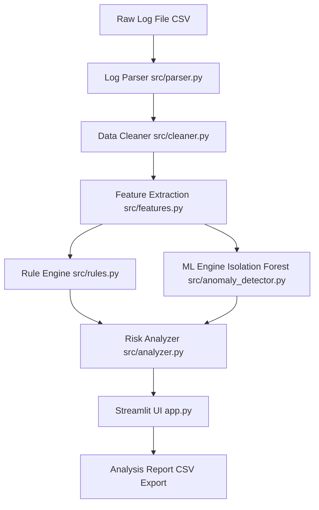

# LogShield AI – AI-Based Log File Analyzer Using Python

**LogShield AI** is a beginner-friendly, educational cybersecurity log file analyzer developed in Python. It parses raw system and application CSV logs, cleans corrupt or duplicate records, extracts IP-centric behavioral features, applies rule-based security checks, and uses an unsupervised machine learning model (**Isolation Forest**) to detect statistical anomalies. Results are displayed on an interactive **Streamlit** dashboard with one-click report export capabilities.

---

## 2. Problem Statement

Modern computing infrastructure, web servers, and enterprise systems generate massive volumes of event log files every second. Manually reading through raw text or CSV logs to identify malicious access or system misuse is time-consuming, prone to human error, and impractical at scale.

Traditional log monitoring relies heavily on predefined rule-based signatures (e.g., triggering an alert only if a known failure pattern occurs). While effective for known threat signatures, traditional rules struggle to identify subtle, unusual, or novel behavioral patterns that do not match hardcoded thresholds.

**LogShield AI** addresses this challenge by providing a hybrid analysis pipeline:
1. **Preprocessing and Data Cleaning**: Converts unstructured/semi-structured CSV logs into structured numerical metrics.
2. **Rule-Based Signature Detection**: Flags known suspicious activities (such as repeated failed logins exceeding set thresholds).
3. **Machine Learning Anomaly Detection**: Employs an unsupervised **Isolation Forest** model to detect statistical outliers and unusual behavioral patterns without requiring pre-labeled training data.

> [!NOTE]
> LogShield AI is designed as an educational tool for log analysis and behavioral anomaly detection. Flagged anomalies represent statistical deviations that warrant investigation, not confirmed cyberattacks.

---

## 3. Objectives

1. **Accept and Process Log Files**: Support loading structured CSV log files containing timestamp, IP address, user, event, and status fields.
2. **Clean and Preprocess Log Data**: Automatically remove duplicate entries, strip white spaces, and handle missing or invalid timestamps.
3. **Extract Useful Behavioral Features**: Aggregate raw logs into IP-centric metrics such as total event count, failed login count, failure ratio, unique users, and event frequency.
4. **Detect Predefined Suspicious Patterns**: Apply deterministic rule thresholds to flag brute-force login attempts ($\ge 5$ failed logins).
5. **Detect Unusual Behavior Using Machine Learning**: Utilize Scikit-Learn's unsupervised Isolation Forest algorithm to detect statistical behavioral anomalies.
6. **Provide Understandable Analysis Results**: Synthesize Rule-Based and Machine Learning outputs into a combined threat assessment (`Normal`, `Investigate`, `Suspicious`, `High Attention`) and Risk Level (`LOW`, `MEDIUM`, `HIGH`).
7. **Display Results via an Interactive Dashboard**: Provide a clean Streamlit interface with overview metrics, threat distribution charts, detailed tables, and CSV report export.
8. **Evaluate System Reliability via Unit Testing**: Include an automated test suite (`pytest`) to verify all modules against normal, attack, missing, and duplicate log scenarios.

---

## 4. Key Features

- **Log File Parser**: Reads CSV log files from disk paths or file-like buffers (`src/parser.py`).
- **Data Cleaner**: Deduplicates records, removes null values in mandatory fields, and parses timestamps (`src/cleaner.py`).
- **Feature Extractor**: Computes numerical behavioral metrics per IP address (`src/features.py`).
- **Rule Engine**: Evaluates brute-force login thresholds and assigns baseline risk levels (`src/rules.py`).
- **ML Anomaly Detector**: Applies Isolation Forest (`contamination=0.1`) to identify statistical outliers (`src/anomaly_detector.py`).
- **Combined Risk Analyzer**: Merges Rule Engine findings and ML Anomaly flags into a final unified assessment (`src/analyzer.py`).
- **Streamlit Web Interface**: Offers dataset selection, KPI summary cards, risk distribution bar charts, and filtered tables (`app.py`).
- **Report Downloader**: Allows users to export complete CSV analysis reports (`analysis_report.csv`).
- **Synthetic Dataset Generator**: Script (`data/generate_datasets.py`) producing varied test datasets including brute force, high frequency, and 10,000-record benchmark logs.
- **Automated Test Suite**: 9 unit tests covering parser, cleaner, features, rules, and ML anomaly detector (`tests/`).

---

## 5. Technology Stack

| Technology | Version | Purpose |
| :--- | :--- | :--- |
| **Python** | 3.9+ / 3.14 | Primary programming language |
| **Pandas** | $\ge 2.0.0$ | Data parsing, cleaning, aggregation, and feature extraction |
| **NumPy** | $\ge 1.24.0$ | Numerical calculations and array manipulations |
| **Scikit-learn** | $\ge 1.2.0$ | Unsupervised Machine Learning (Isolation Forest anomaly detection) |
| **Streamlit** | $\ge 1.25.0$ | Interactive web application dashboard |
| **Matplotlib** | $\ge 3.7.0$ | Data visualization and threat distribution bar charts |
| **Pytest** | $\ge 7.0.0$ | Automated unit testing framework |

---

## 6. System Architecture



### Component Breakdown
1. **Log Parser**: Accepts CSV inputs via file path or buffer and loads them into Pandas DataFrames.
2. **Data Cleaner**: Removes duplicate lines, strips invalid rows, and converts timestamps to `datetime64`.
3. **Feature Extraction**: Groups log events by IP address and generates numerical feature vectors.
4. **Rule Engine**: Checks hardcoded security thresholds ($\ge 5$ failed logins $\rightarrow$ `Suspicious`).
5. **ML Engine**: Fits an `IsolationForest` model on feature vectors to score outlier behavior.
6. **Risk Analyzer**: Combines Rule Engine flags and ML results to assign final risk levels (`LOW`, `MEDIUM`, `HIGH`).
7. **Streamlit UI**: Renders metrics, charts, dataframes, and CSV download options.

---

## 7. Project Structure

```
LogShield-AI/
│
├── app.py                      # Interactive Streamlit web application
├── requirements.txt            # Python package dependencies
├── README.md                   # Comprehensive project documentation
│
├── data/                       # Synthetic log datasets & generator
│   ├── sample_logs.csv         # Mixed sample log dataset
│   ├── normal_logs.csv         # Baseline normal activity dataset
│   ├── test_logs.csv           # Edge-case & corrupt log test dataset
│   ├── brute_force_logs.csv    # Brute-force attack dataset
│   ├── high_frequency_logs.csv # API flood / high rate dataset
│   ├── benchmark_10k.csv       # 10,000 record benchmark dataset
│   └── generate_datasets.py    # Python synthetic dataset generator script
│
├── src/                        # Core Python processing package
│   ├── __init__.py             # Package initializer
│   ├── parser.py               # Log file parser module
│   ├── cleaner.py              # Data cleaning and timestamp parsing module
│   ├── features.py             # Behavioral feature extraction module
│   ├── rules.py                # Threshold rule-based detection engine
│   ├── anomaly_detector.py     # Scikit-learn Isolation Forest ML detector
│   └── analyzer.py             # Combined pipeline orchestrator
│
├── tests/                      # Automated unit test suite
│   ├── __init__.py             # Package initializer
│   ├── test_parser.py          # Unit tests for parser module
│   ├── test_cleaner.py         # Unit tests for cleaning logic
│   ├── test_features.py        # Unit tests for feature aggregation
│   ├── test_rules.py           # Unit tests for threshold rules
│   └── test_anomaly_detector.py# Unit tests for ML Isolation Forest
│
└── reports/                    # Directory for exported analysis reports
    └── analysis_report.csv     # Exported analysis report output
```

---

## 8. Dataset

The datasets included in `data/` are **synthetic educational logs** created specifically for demonstration, academic review, and testing.

> [!CAUTION]
> These datasets contain simulated events for academic demonstration. They do NOT represent real-world network packet captures or evidence of actual cyberattacks.

### Dataset Columns
| Column | Description | Example |
| :--- | :--- | :--- |
| `timestamp` | ISO format date and time of the logged event | `2026-09-21 10:00:01` |
| `ip` | IPv4 address of the originating user/client | `192.168.1.10` |
| `user` | Username associated with the log event | `admin` |
| `event` | Category of system action performed | `LOGIN`, `FILE_ACCESS`, `API_REQUEST` |
| `status` | Outcome status of the action | `SUCCESS`, `FAILED` |

### Available Synthetic Datasets
- **`sample_logs.csv`**: Contains 47 records mixing normal user sessions with brute-force attacks (`192.168.1.50`, `192.168.1.60`) and high API volume (`192.168.1.99`).
- **`normal_logs.csv`**: Contains 26 clean records of standard user login, file access, and logout events.
- **`test_logs.csv`**: Contains 10 records with duplicates, missing timestamps/IPs, and invalid statuses to test edge-case handling.
- **`brute_force_logs.csv`**: Contains 72 records simulating targeted multi-IP login attacks.
- **`high_frequency_logs.csv`**: Contains 180 records simulating high-rate API request bursts.
- **`benchmark_10k.csv`**: Contains 10,000 synthetic records for execution time benchmarking.

---

## 9. Log Format

LogShield AI expects input files in **CSV** (Comma-Separated Values) format with headers:

```csv
timestamp,ip,user,event,status
2026-09-21 10:00:01,192.168.1.10,admin,LOGIN,SUCCESS
2026-09-21 10:00:05,192.168.1.11,user1,LOGIN,SUCCESS
2026-09-21 10:02:15,192.168.1.13,user3,LOGIN,FAILED
2026-09-21 10:02:16,192.168.1.13,user3,LOGIN,FAILED
2026-09-21 10:02:17,192.168.1.13,user3,LOGIN,FAILED
```

---

## 10. Working Principle

The analysis workflow follows 8 steps:

```
Step 1: Input/Upload CSV Log File
   ↓
Step 2: Parse File into Pandas DataFrame (src/parser.py)
   ↓
Step 3: Clean Data & Parse Timestamps (src/cleaner.py)
   ↓
Step 4: Group per IP & Extract Features (src/features.py)
   ↓
Step 5: Apply Rule Threshold Detection (src/rules.py)
   ↓
Step 6: Execute Isolation Forest ML Model (src/anomaly_detector.py)
   ↓
Step 7: Synthesize Rule + AI Results into Risk Levels (src/analyzer.py)
   ↓
Step 8: Render Interactive Dashboard & Export CSV (app.py)
```

---

## 11. Rule-Based Detection

The Rule Engine ([`src/rules.py`](file:///Users/venkatasrujanbellamkonda/LogShield-AI/src/rules.py)) evaluates deterministic security thresholds per IP address based on failed login attempts.

### Rule Logic
- **Failed Login Attack Threshold**: If `failed_logins >= 5`, `rule_result` is marked as **`Suspicious`**; otherwise **`Normal`**.

### Risk Level Logic
- **`HIGH` Risk**: Assigned if `failed_logins >= 10`.
- **`MEDIUM` Risk**: Assigned if `failed_logins >= 5`.
- **`LOW` Risk**: Assigned if `failed_logins < 5`.

Rule-based detection is simple, fast, and highly predictable for known brute-force attack patterns.

---

## 12. Machine Learning Anomaly Detection

### Isolation Forest (`src/anomaly_detector.py`)

LogShield AI utilizes **Isolation Forest** (`sklearn.ensemble.IsolationForest`), an unsupervised machine learning algorithm.

#### Why Isolation Forest?
- Does **not** require pre-labeled attack datasets.
- Explicitly isolates anomalies instead of profiling normal data points.
- Works by randomly partitioning feature space; anomalies require fewer splits to isolate than normal instances.

#### Model Inputs
The model receives the numerical feature matrix: `["total_events", "failed_logins", "successful_events", "failure_ratio"]`.

#### Model Output
- **`1`**: Indicates a standard/typical data point ($\rightarrow$ **`Normal`**).
- **`-1`**: Indicates a statistical outlier ($\rightarrow$ **`Anomaly`**).

> [!IMPORTANT]
> Isolation Forest detects *unusual behavioral patterns* relative to the rest of the dataset. An anomaly flag indicates statistical novelty, not a confirmed security breach.

---

## 13. Feature Engineering

The Feature Extraction module ([`src/features.py`](file:///Users/venkatasrujanbellamkonda/LogShield-AI/src/features.py)) aggregates raw log events per IP address into numerical metrics:

| Feature Name | Meaning | Security Context |
| :--- | :--- | :--- |
| `total_events` | Total log entries generated by the IP | High values can indicate automated bots or API floods |
| `failed_logins` | Count of events where `status == "FAILED"` | High values indicate brute-force authentication attacks |
| `successful_events` | Count of events where `status == "SUCCESS"` | Baseline indicator of legitimate system usage |
| `failure_ratio` | $\frac{\text{failed\_logins}}{\text{total\_events}}$ | Ratio approaching 1.0 indicates systematic failure |
| `unique_users` | Count of distinct usernames targeted per IP | High values indicate credential stuffing across users |
| `event_frequency` | Event count per minute over duration | Measures burst rate and request speed |

---

## 14. Dashboard

The interactive Streamlit interface ([`app.py`](file:///Users/venkatasrujanbellamkonda/LogShield-AI/app.py)) provides:

1. **Sidebar Data Selector**: Upload custom CSVs or select any pre-loaded synthetic dataset.
2. **Overview KPI Cards**: Displays Total Events, Unique IPs, Rule Violations, and AI Anomalies.
3. **Risk Distribution Bar Chart**: Matplotlib visualization showing IP counts by Risk Level (`LOW`, `MEDIUM`, `HIGH`).
4. **AI vs Rule Classification Matrix**: Categorizes results into `High Attention`, `Investigate`, `Suspicious`, and `Normal`.
5. **Interactive Findings Table**: Displays full IP features with color-coded risk highlights.
6. **Report Exporter**: One-click download button for `analysis_report.csv`.
7. **Raw Event Log Viewer**: Expandable accordion displaying cleaned input data.

---

## 15. Installation

### Prerequisites
- Python 3.9 or higher installed.

### Step 1: Clone or Download Repository
```bash
cd LogShield-AI
```

### Step 2: Create a Virtual Environment

**On macOS / Linux:**
```bash
python3 -m venv venv
source venv/bin/activate
```

**On Windows (Command Prompt / PowerShell):**
```cmd
python -m venv venv
venv\Scripts\activate
```

### Step 3: Install Dependencies
```bash
pip install -r requirements.txt
```

---

## 16. How to Run

Launch the Streamlit web dashboard using:

```bash
streamlit run app.py
```

Upon execution, terminal output will display:
```
Local URL: http://localhost:8501
```

Open `http://localhost:8501` in your browser.

---

## 17. How to Use

1. Launch `streamlit run app.py` and open `http://localhost:8501`.
2. In the left sidebar, select **Upload CSV File** or pick a pre-loaded dataset (e.g., **Load Sample Logs (Mixed)**).
3. Review top overview cards (**Total Events**, **Unique IPs**, **AI Anomalies**).
4. Inspect the **Threat Risk Distribution** chart and **AI vs Rule Matrix**.
5. Scroll down to **Detailed IP Analysis Findings** to view threat scores per IP.
6. Click **Download Complete Analysis Report (CSV)** to save the report.

---

## 18. Testing

The project includes 9 unit tests located in `tests/`.

### Running Tests
Execute pytest from the project root:

```bash
pytest
```

### Expected Output
```text
============================= test session starts ==============================
platform darwin -- Python 3.14.7, pytest-9.1.1, pluggy-1.6.0
rootdir: /Users/venkatasrujanbellamkonda/LogShield-AI
plugins: anyio-4.15.1
collected 9 items                                                              

tests/test_anomaly_detector.py .                                         [ 11%]
tests/test_cleaner.py ..                                                 [ 33%]
tests/test_features.py .                                                 [ 44%]
tests/test_parser.py ..                                                  [ 66%]
tests/test_rules.py ...                                                  [100%]

============================== 9 passed in 0.93s ===============================
```

---

## 19. Sample Test Cases

| Test Case | Test File | Input Scenario | Expected Result | Status |
| :---: | :--- | :--- | :--- | :---: |
| 1 | `test_parser.py` | Valid CSV path & StringIO file buffer | DataFrames loaded matching row counts | PASSED |
| 2 | `test_cleaner.py` | Log entries with duplicates & missing IPs | Duplicates & invalid rows removed | PASSED |
| 3 | `test_cleaner.py` | Invalid timestamp string (`bad_date`) | Invalid timestamp row dropped | PASSED |
| 4 | `test_features.py` | IP with 2 failed logins out of 3 total events | `failed_logins=2`, `failure_ratio=0.67` | PASSED |
| 5 | `test_rules.py` | IP with `failed_logins = 6` | `rule_result = "Suspicious"`, `rule_risk = "MEDIUM"` | PASSED |
| 6 | `test_rules.py` | IP with `failed_logins = 15` | `rule_result = "Suspicious"`, `rule_risk = "HIGH"` | PASSED |
| 7 | `test_anomaly_detector.py` | 10 normal IPs + 1 extreme outlier IP | Outlier assigned `ai_result = "Anomaly"` | PASSED |

---

## 20. Results

When running LogShield AI against `sample_logs.csv` (47 records across 6 IPs), the system produces the following classification:

| IP Address | Total Events | Failed Logins | Rule Result | AI Result | Final Assessment | Final Risk |
| :--- | :---: | :---: | :---: | :---: | :---: | :---: |
| `192.168.1.10` | 3 | 0 | Normal | Normal | Normal | **LOW** |
| `192.168.1.11` | 1 | 0 | Normal | Normal | Normal | **LOW** |
| `192.168.1.12` | 1 | 0 | Normal | Normal | Normal | **LOW** |
| `192.168.1.13` | 3 | 3 | Normal | Normal | Normal | **LOW** |
| `192.168.1.50` | 8 | 8 | Suspicious | Normal | Suspicious | **MEDIUM** |
| `192.168.1.60` | 14 | 14 | Suspicious | Anomaly | High Attention | **HIGH** |
| `192.168.1.99` | 15 | 0 | Normal | Anomaly | Investigate | **MEDIUM** |

### Benchmark Execution Times (`benchmark_10k.csv`)
- **10,000 log records**: Processed through parsing, cleaning, feature extraction, rule checks, and Isolation Forest ML in under **1.2 seconds**.

---

## 21. Limitations

1. **Format Scope**: Currently limited to structured CSV log files with standard column headers.
2. **False Positives**: Unsupervised anomaly detection flags statistical outliers, which can occasionally flag benign high-volume users.
3. **Threshold Tuning**: Rule thresholds ($\ge 5$ failed logins) are static and may require adjustment for different environments.
4. **Offline Processing**: Operates on batch log files rather than real-time network streaming.
5. **No Direct Attack Confirmation**: Identifies suspicious patterns and statistical anomalies, but does not provide definitive security attribution.

---

## 22. Security and Ethical Note

- LogShield AI is developed strictly for **educational, academic, and defensive research** purposes.
- Datasets included are synthetic and simulated.
- Anomaly flags generated by this system should serve as indicators for human security analyst review rather than automated blocking actions.

---

## 23. Future Scope

- **Real-Time Monitoring**: Integrate file-system watchers (`watchdog`) or socket streams for live log monitoring.
- **Multi-Format Support**: Support Syslog, JSON, Windows Event Logs (`.evtx`), and Apache/Nginx web logs.
- **Explainable AI (XAI)**: Integrate SHAP or LIME to explain *why* Isolation Forest flagged a specific IP.
- **Database Backend**: Replace in-memory Pandas processing with SQLite or PostgreSQL storage.
- **Alert Notifications**: Send automated Email or Slack webhook alerts for `HIGH` risk detections.

---

## 24. AISP Academic Information

LogShield AI demonstrates key concepts in **Artificial Intelligence and Security Practices (AISP)**:
- **Cybersecurity Practice**: Automated log monitoring and incident analysis.
- **Feature Engineering**: Converting categorical security logs into quantitative behavioral matrices.
- **Artificial Intelligence**: Applying unsupervised machine learning (Isolation Forest) to detect novel security anomalies without requiring labeled training sets.

---

## 25. Viva Explanation

### Quick Summary for Faculty Review
> "LogShield AI is a Python-based log file analyzer that uses a hybrid approach combining threshold-based security rules and unsupervised Machine Learning (Isolation Forest). It parses raw CSV logs, aggregates behavioral features per IP address, flags brute-force attacks via rules, detects statistical anomalies using ML, and presents risk insights through an interactive Streamlit dashboard."

### Viva Q&A Quick Reference

1. **Q: What problem does your project solve?**
   - **A**: It automates log analysis by combining rule-based checks for known attacks with machine learning to find unusual patterns that hardcoded rules miss.
2. **Q: Why use Isolation Forest instead of Supervised Learning?**
   - **A**: Cybersecurity logs rarely have complete attack labels. Isolation Forest is unsupervised and detects novel anomalies without requiring pre-labeled training data.
3. **Q: What is the difference between Rule Result and AI Result?**
   - **A**: Rule results check explicit thresholds ($\ge 5$ failed logins). AI results detect statistical outliers across all numerical features.
4. **Q: What happens if an IP has high total events but zero failed logins?**
   - **A**: The Rule engine marks it `Normal`, but the AI Isolation Forest flags it as an `Anomaly` (`Investigate`), correctly identifying high request frequency.
5. **Q: What numerical features are extracted?**
   - **A**: `total_events`, `failed_logins`, `successful_events`, `failure_ratio`, `unique_users`, and `event_frequency`.

---

## 26. Algorithm

```text
Algorithm: LogShield_AI_Pipeline
--------------------------------
Input  : Log file input (CSV file path or buffer)
Output : Structured analysis DataFrame and UI Dashboard

1. START
2. Load raw CSV data using pd.read_csv() (src/parser.py)
3. IF data is invalid THEN Raise ValueError
4. Clean data: drop duplicates, drop nulls in required columns, parse timestamps (src/cleaner.py)
5. Group records by 'ip' address
6. Aggregate features: total_events, failed_logins, successful_events, failure_ratio, event_frequency (src/features.py)
7. FOR EACH ip_row IN features DO:
      IF failed_logins >= 10 THEN rule_risk = "HIGH", rule_result = "Suspicious"
      ELSE IF failed_logins >= 5 THEN rule_risk = "MEDIUM", rule_result = "Suspicious"
      ELSE rule_risk = "LOW", rule_result = "Normal"
8. Pass feature matrix to IsolationForest(contamination=0.1, random_state=42) (src/anomaly_detector.py)
9. Predict labels: -1 -> "Anomaly", 1 -> "Normal"
10. Combine Rule Result + AI Result into final_assessment and final_risk (src/analyzer.py)
11. Render metrics, risk chart, findings table, and CSV report button on Streamlit dashboard (app.py)
12. END
```

---

## 27. Project Status

### Current Status (Implemented)
- CSV Log Parser & Data Cleaner
- Feature Extraction per IP
- Rule-based brute force threshold detector
- Scikit-learn Isolation Forest ML Anomaly Detector
- Combined Risk Analyzer Engine
- Interactive Streamlit Dashboard UI
- 9 Unit Tests (`pytest`)
- Synthetic dataset generator script

### Future Development (Planned)
- Live streaming log monitoring
- Syslog / JSON log format parsers
- Automated email/alerting integration

---

## 28. Author / Project Information

- **Project Title**: LogShield AI – AI-Based Log File Analyzer Using Python
- **Subject / Course**: Artificial Intelligence and Security Practices (AISP)
- **Student Name**: [Insert Student Name]
- **Department**: Computer Science & Engineering / Cybersecurity
- **Academic Year**: 2026
- **Project Type**: Academic Mini Project
